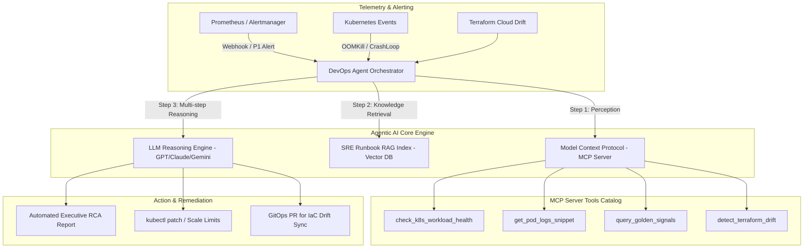

# 🤖 Autonomous DevOps & SRE AI Agent (MCP + RAG + LLM)

[](https://www.python.org/)
[](https://modelcontextprotocol.io/)
[](https://kubernetes.io/)
[](https://prometheus.io/)
[](https://www.docker.com/)
[](https://helm.sh/)

An enterprise-grade, autonomous Site Reliability Engineering (SRE) and DevOps AI Agent. Designed to accelerate root cause analysis (RCA), reduce Mean Time to Resolution (MTTR), and eliminate incident toil by unifying **Model Context Protocol (MCP)**, **Retrieval-Augmented Generation (RAG)** over postmortems, and **LLM multi-step reasoning**.

---

## 🏛️ System Architecture



---

## ⚡ Core Capabilities

- **Model Context Protocol (MCP) Server**: Standardized tool interface exposing real-time Kubernetes diagnostics, Prometheus telemetry, and Terraform drift auditing directly to AI assistants.
- **SRE Runbook RAG**: Semantic vector retrieval over internal incident postmortems, triage runbooks, and failure-mode catalogs to pinpoint proven resolutions.
- **Golden Signals Telemetry Correlation**: Automatically computes Latency, Traffic, Errors, and Saturation, calculating instantaneous SLI/SLO error budget burn rate.
- **Autonomous RCA Generation**: Produces formatted, leadership-ready Root Cause Analysis markdown reports detailing timelines, impact, and preventive measures.

---

## 📁 Repository Layout

```
agentic-devops-mcp-agent/
├── agent/
│   ├── orchestrator.py         # Autonomous Agent loop with multi-step reasoning
│   ├── prompts.py              # SRE system prompts and reasoning constraints
│   └── rca_generator.py        # Executive RCA generation engine
├── mcp_server/
│   ├── server.py               # FastAPI-based Model Context Protocol server
│   ├── tools_k8s.py            # Kubernetes pod health & log triage tools
│   ├── tools_prometheus.py     # Prometheus 4 Golden Signals & SLO burn rate tools
│   └── tools_iac.py            # Terraform state vs live cloud drift detection
├── rag/
│   ├── vector_store.py         # RAG semantic vector search engine
│   └── runbooks/               # SRE runbooks (OOMKills, 504 Timeouts, Connection pools)
├── helm/
│   └── agentic-devops-agent/   # Helm 3 chart for deploying inside AKS/Kubernetes
├── tests/                      # Pytest automated test suite
├── Dockerfile                  # Production multi-stage container build
└── docker-compose.yml          # Local container orchestration
```

---

## 🚀 Quickstart & Usage

### 1. Run via Docker Compose
```bash
git clone https://github.com/Mit-Yadav/agentic-devops-mcp-agent.git
cd agentic-devops-mcp-agent

# Build and start the MCP server
docker compose up -d

# Verify server health
curl http://localhost:8000/health
```

### 2. Inspect Available MCP Tools
```bash
curl http://localhost:8000/mcp/tools
```

### 3. Trigger Autonomous Incident Triage
```bash
# Run the agent orchestrator
python -m agent.orchestrator
```

### Sample Automated RCA Output:
```
================================================================================
             INCIDENT ROOT CAUSE ANALYSIS (RCA) REPORT
================================================================================
Incident ID:          INC-2026-8841
Severity:             P1 - Critical
Impacted Service:     payment-api
Primary Cause:        Container memory limit exceeded (OOMKilled exit 137)
MTTR Saved:           Estimated 42 minutes through automated agent triage

1. EXECUTIVE SUMMARY:
   The payment-api service experienced repeated CrashLoopBackOff failures 
   under sustained peak traffic. Prometheus metrics revealed a memory saturation 
   of 99.2% resulting in Linux cgroup SIGKILL terminations.

2. EVIDENCE GATHERED (via MCP Server):
   - K8s Pod Status:  CrashLoopBackOff (restarts: 14)
   - Error Budget:    Burn rate 14.2x (SLO breached from 99.9% to 97.4%)
   - Log Trace:       OutOfMemoryError allocating 128MB batch chunk

3. RUNBOOK CORRELATION (via SRE RAG):
   - Matched Runbook: oomkill_remediation.md (Score: 0.94)

4. REMEDIATION ACTION PLAN:
   [Immediate] kubectl patch deployment payment-api -p '{"spec":{"template":{"spec":{"containers":[{"name":"app","resources":{"limits":{"memory":"1Gi"}}}]}}}}'
   [Preventive] Tune KEDA scaledobject to trigger HPA scaling at 75% memory utilization.
================================================================================
```

---

## 🔌 Connecting to Claude Desktop / Antigravity / Cursor MCP Client

Add the following configuration to your `claude_desktop_config.json`:

```json
{
  "mcpServers": {
    "devops-sre-agent": {
      "command": "python",
      "args": ["-m", "mcp_server.server"],
      "env": {
        "ENVIRONMENT": "production"
      }
    }
  }
}
```

---

## 🧪 Testing

```bash
pip install -r requirements.txt
pytest tests/ -v
```

---
**Maintained by [Mithilesh Yadav](https://github.com/Mit-Yadav)** | Enterprise DevOps & SRE Engineer | Cloud & Agentic AI Architect
